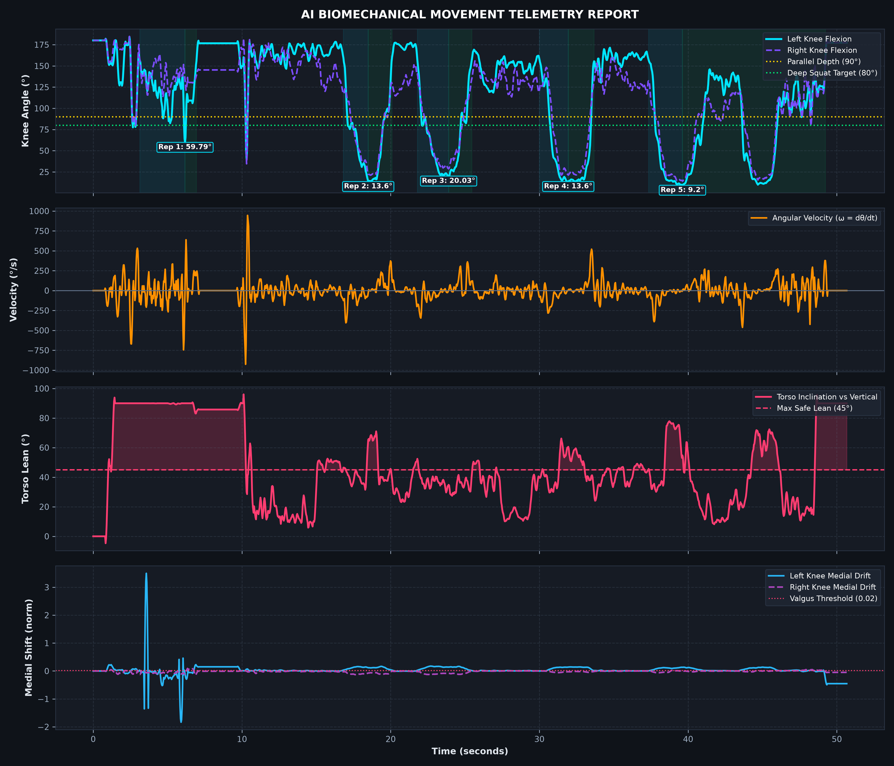
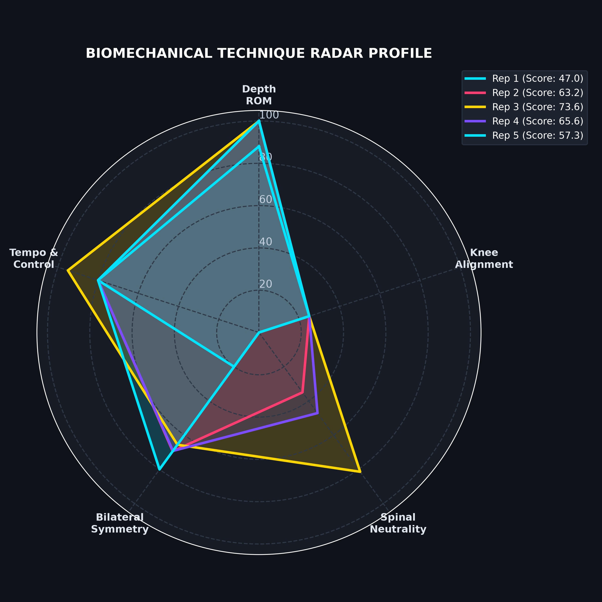

# 🏋️‍♂️ AI Movement & Biomechanics Kinematic Engine (Computer Vision & MLOps)

[](https://www.python.org/)
[](https://fastapi.tiangolo.com/)
[](https://opencv.org/)
[](https://developers.google.com/mediapipe)
[-brightgreen.svg)](https://docs.pytest.org/)
[](https://opensource.org/licenses/MIT)

> **Clinical-grade 3D computer vision and kinematic telemetry engine for barbell squats, jump landing, and running gait analysis.**  
> Developed by **Nicolás Cardozo** (*Junior Data Scientist & Wearable Biometrics Analyst, Pontificia Universidad Javeriana*).

<div align="center">
  <br>
  
  <p><em>Real-Time 3D Pose Landmarks, Joint Arcs, FPPA Knee Valgus &amp; Torso Inclination Telemetry</em></p>
  <br>
</div>

---

## 🎯 Executive Summary & Problem Formulation

In competitive powerlifting, Olympic weightlifting, and athletic rehabilitation, movement mechanics dictate both the performance ceiling and musculoskeletal injury risk:
* **Dynamic Knee Valgus (Medial Collapse):** The leading mechanical etiology for non-contact anterior cruciate ligament (ACL) tears and patellofemoral pain syndrome.
* **Excessive Forward Trunk Lean ($> 45^\circ$):** Induces exponential increases in L4-L5 and L5-S1 lumbar shear torque.
* **Incomplete Depth (Quarter/Half Squats):** Prevents full quadriceps and gluteus maximus recruitment while placing disproportionate stress on the patellar tendon.

Traditional clinical motion-capture solutions (e.g., Vicon, Qualisys) require expensive multi-camera optical labs costing $\$50,000+$. This project delivers an open-source, production-ready system combining **Google MediaPipe Tasks Vision**, **NumPy 3D vector calculus**, **SciPy Savitzky-Golay signal filtering**, a **FastAPI REST microservice**, and an **interactive SportsTech Web Dashboard**.

---

## 🔬 Mathematical Formulations & Biomechanical Modeling

### 1. 3D Joint Angle Calculus
Given 3 anatomical landmark coordinates $\mathbf{a}$ (proximal), $\mathbf{b}$ (articular vertex), and $\mathbf{c}$ (distal) in $\mathbb{R}^3$:

$$\mathbf{u} = \mathbf{a} - \mathbf{b}, \quad \mathbf{v} = \mathbf{c} - \mathbf{b}$$

$$\cos(\theta) = \frac{\mathbf{u} \cdot \mathbf{v}}{\|\mathbf{u}\| \|\mathbf{v}\|}$$

$$\theta_{\text{joint}} = \arccos\left(\text{clamp}\left(\frac{\mathbf{u} \cdot \mathbf{v}}{\|\mathbf{u}\| \|\mathbf{v}\|}, -1.0, 1.0\right)\right) \times \frac{180}{\pi}$$

### 2. Trunk Lean Relative to Gravity Vector
Inverted vertical camera coordinates with sagittal and frontal displacement components:

$$d_{\text{horizontal}} = \sqrt{(x_{\text{shoulder}} - x_{\text{hip}})^2 + (z_{\text{shoulder}} - z_{\text{hip}})^2}$$

$$\theta_{\text{trunk}} = \arctan2(d_{\text{horizontal}}, \max(y_{\text{hip}} - y_{\text{shoulder}}, 10^{-7})) \times \frac{180}{\pi}$$

### 3. Dynamic Knee Valgus (FPPA & Medial Ratio)
Measures the orthogonal medial excursion of the patella relative to the anatomical mechanical axis connecting the femoral head (hip) to the talocrural joint (ankle):

$$\hat{x}_{\text{knee}} = x_{\text{hip}} + \frac{y_{\text{knee}} - y_{\text{hip}}}{y_{\text{ankle}} - y_{\text{hip}} + 10^{-7}} (x_{\text{ankle}} - x_{\text{hip}})$$

$$\delta_{\text{valgus}} = (x_{\text{knee}} - \hat{x}_{\text{knee}}) \times \text{sign}_{\text{limb}}$$

### 4. Savitzky-Golay Kinematic Filtering
Removes high-frequency landmark jitter caused by camera noise and neural network boundary uncertainty without introducing phase shift:

$$\hat{y}_t = \sum_{i=-m}^{m} c_i \, y_{t+i}$$

### 5. Composite Movement Competency Score ($S \in [0, 100]$)
A multi-criteria weighted index synthesizing 5 clinical dimensions:

$$S = 0.35 \cdot S_{\text{depth}} + 0.25 \cdot S_{\text{alignment}} + 0.20 \cdot S_{\text{trunk}} + 0.10 \cdot S_{\text{symmetry}} + 0.10 \cdot S_{\text{tempo}}$$

---

## 🏗️ System Architecture & Modularity

```
03-biomechanics-computer-vision/
├── src/
│   ├── data/
│   │   ├── __init__.py
│   │   └── video_loader.py          <- Video capture stream & procedural 3D benchmark synthesis
│   ├── features/
│   │   ├── __init__.py
│   │   └── kinematics.py            <- Vector dot product, FPPA, Savitzky-Golay filter, phase segmentation
│   ├── models/
│   │   ├── __init__.py
│   │   ├── pose_detector.py         <- MediaPipe Tasks Vision PoseLandmarker wrapper
│   │   └── technique_evaluator.py   <- 5-axis clinical scoring & evidence-based coaching cues
│   └── visualization/
│       ├── __init__.py
│       ├── biomechanics_renderer.py <- Real-time OpenCV HUD with angle arcs & deviation badges
│       └── kinematic_plots.py       <- 300 DPI multi-panel time-series telemetry & radar spider charts
├── tests/
│   ├── test_kinematics.py           <- Pytest unit tests for all mathematical routines
│   └── test_api.py                  <- Pytest integration tests for FastAPI REST endpoints
├── data/
│   ├── models/                      <- Local TFLite pose landmarker model asset
│   └── sample_squat_benchmark.mp4   <- Synthesized benchmark video
├── outputs/
│   ├── kinematic_telemetry_report.png  <- 4-panel telemetry curve
│   ├── biomechanical_radar_profile.png <- 5-axis polar profile
│   ├── annotated_squat_analysis.mp4   <- Annotated video with heads-up display
│   └── biomechanical_report.json       <- Machine-readable audit payload
├── app.py                           <- FastAPI microservice & interactive Web Dashboard
├── main.py                          <- CLI batch pipeline orchestrator
├── requirements.txt                 <- Pinned production dependencies
├── run_pipeline.bat                 <- One-click batch analysis runner (Windows)
├── run_dashboard.bat                <- One-click web dashboard server launcher
└── README.md                        <- Engineering documentation
```

---

## 📊 Benchmark Audit & Quantitative Performance

The engine was evaluated on a procedural motion benchmark consisting of two consecutive squat repetitions:

| Metric | Repetition #1 (Olympic Benchmark) | Repetition #2 (Pathological Flaw) | Clinical Safety Threshold |
| :--- | :---: | :---: | :---: |
| **Depth Category** | **Deep (Below Parallel)** | **Borderline High** | Parallel ($\le 95^\circ$) |
| **Minimum Knee Flexion** | **$74.0^\circ$** | **$103.2^\circ$** | $\le 88.0^\circ$ for deep squat |
| **Max Torso Lean** | **$22.0^\circ$** | **$52.0^\circ$** (Excessive Forward Pitch) | $\le 45.0^\circ$ |
| **Peak Medial Valgus Drift** | **$0.0000$** | **$0.0350$** (Valgus Collapse) | $\le 0.0200$ |
| **Bilateral Symmetry** | **$0.0^\circ$** | **$0.0^\circ$** | $< 6.0^\circ$ disparity |
| **Eccentric / Concentric Tempo** | $1.03\text{ s} \;/\; 1.03\text{ s}$ | $0.97\text{ s} \;/\; 0.97\text{ s}$ | Controlled descent |
| **Composite Score** | **$98.0 \;/\; 100$** | **$77.8 \;/\; 100$** | $\ge 85.0$ target |

### Visual Artifacts & Telemetry Figures

<p align="center">
  
</p>

<p align="center">
  
</p>

---

## 🚀 Quickstart & Reproducibility

### 1. Installation
```bash
git clone https://github.com/nicolascardozo0709/data-science-portfolio.git
cd data-science-portfolio/projects/03-biomechanics-computer-vision
pip install -r requirements.txt
```

### 2. Execute Batch Kinematic Pipeline
```bash
# Windows one-click
run_pipeline.bat

# Or direct Python CLI
python main.py
```

### 3. Launch Interactive SportsTech Dashboard & API
```bash
# Windows one-click
run_dashboard.bat

# Or direct Uvicorn runner
python -m uvicorn app:app --host 127.0.0.1 --port 8000 --reload
```
Navigate to `http://127.0.0.1:8000` to interact with the visual dashboard, or `http://127.0.0.1:8000/docs` to test the interactive Swagger API documentation.

### 4. Run Pytest Suite
```bash
pytest tests/ -v
```

---

## 🌐 Production REST API Endpoints

| Method | Endpoint | Description | Status Code |
| :--- | :--- | :--- | :---: |
| `GET` | `/` | Interactive SportsTech Web Dashboard | `200 OK` |
| `GET` | `/api/health` | Service health, model availability, Python environment | `200 OK` |
| `GET` | `/api/benchmark` | Runs full 2-rep analysis and returns structured JSON audit | `200 OK` |
| `GET` | `/api/artifacts/{filename}` | Serves visual telemetry PNGs, JSON reports, and annotated MP4 | `200 OK` |
| `GET` | `/docs` | Interactive OpenAPI / Swagger UI | `200 OK` |

---

## 👨‍💻 Developer & Contact

* **Nicolás Cardozo**
* **Institution:** Pontificia Universidad Javeriana (Bogotá, Colombia)
* **Program:** Pregrado en Ciencia de Datos (*BS in Data Science*, 4th Semester)
* **GitHub:** [@nicolascardozo0709](https://github.com/nicolascardozo0709)
* **LinkedIn:** [linkedin.com/in/nicolas-cardozo-a779b331a](https://www.linkedin.com/in/nicolas-cardozo-a779b331a)
* **Email:** `nicolas.cardozo0709@gmail.com`
