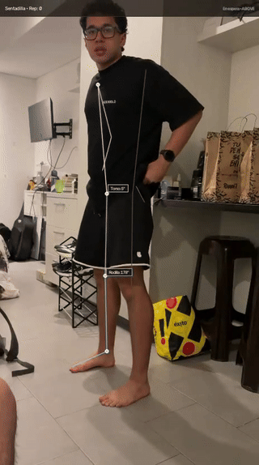

# 🏋️‍♂️ AI Movement & Biomechanics Kinematic Engine (Computer Vision & MLOps)

[](https://www.python.org/)
[](https://fastapi.tiangolo.com/)
[](https://opencv.org/)
[](https://developers.google.com/mediapipe)
[-brightgreen.svg)](https://docs.pytest.org/)
[](https://www.docker.com/)
[](https://opensource.org/licenses/MIT)

> **Clinical-grade 3D computer vision and kinematic telemetry engine for barbell squats, push-ups, jump landing, and movement biomechanics.**  
> Developed by **Nicolás Cardozo** (*Junior Data Scientist & Wearable Biometrics Analyst, Pontificia Universidad Javeriana*).

<div align="center">
  <br>
  
  <p><em>Real-Time 3D Pose Landmarks, Joint Arcs, FPPA Knee Valgus, Elbow Flexion &amp; Core Plank Telemetry</em></p>
  <br>
</div>

---

## 🎯 Executive Summary & Problem Formulation

In athletic training, Olympic weightlifting, military physical tests, and musculoskeletal rehabilitation, movement mechanics dictate performance ceilings and injury hazards:
* **Dynamic Knee Valgus (Medial Collapse):** The primary mechanical cause of non-contact ACL tears and patellofemoral syndrome in squats.
* **Excessive Forward Trunk Lean ($> 45^\circ$):** Induces dangerous shear forces across the L4-L5 and L5-S1 lumbar spine.
* **Incomplete Squat Depth:** Limits full quadriceps and gluteal activation while overloading the patellar tendon.
* **Push-Up Depth & Elbow ROM ($> 90^\circ$):** Partial push-ups fail military and clinical standards, reducing pectoral recruitment.
* **Plank & Core Instability (Hip Sag / Anterior Pelvic Tilt):** Hyperextends the lumbar spine under compressive load during push-ups.

This engine delivers a fully automated, scientific movement audit pipeline using **Google MediaPipe Tasks Vision Heavy (29.2 MB)**, **NumPy 3D vector calculus**, **SciPy Savitzky-Golay filtering**, a **FastAPI REST microservice**, and an **interactive Dark-Mode Dashboard**.

---

## 🔬 Mathematical Formulations & Biomechanical Modeling

### 1. 3D Joint Angle Calculus
Given 3 anatomical landmark coordinates $\mathbf{a}$ (proximal), $\mathbf{b}$ (articular vertex), and $\mathbf{c}$ (distal) in $\mathbb{R}^3$:

$$\mathbf{u} = \mathbf{a} - \mathbf{b}, \quad \mathbf{v} = \mathbf{c} - \mathbf{b}$$

$$\theta_{\text{joint}} = \arccos\left(\text{clamp}\left(\frac{\mathbf{u} \cdot \mathbf{v}}{\|\mathbf{u}\| \|\mathbf{v}\|}, -1.0, 1.0\right)\right) \times \frac{180}{\pi}$$

### 2. Isotropic Aspect-Ratio Scaling
Eliminates angular distortion from non-square camera aspect ratios (e.g., 9:16 vertical smartphone recordings) by mapping coordinates to physical metric space:

$$p_x = x \cdot W, \quad p_y = y \cdot H$$

### 3. Push-Up Kinematics: Elbow ROM & Core Collinearity
* **Elbow Flexion ($\theta_{\text{elbow}}$):** Formed across Shoulder $\to$ Elbow $\to$ Wrist. Full lockout: $\ge 160^\circ$; Full military depth: $\le 90^\circ$.
* **Plank Core Alignment ($\theta_{\text{plank}}$):** Formed across Shoulder $\to$ Hip $\to$ Ankle. Ideal neutral spine: $170^\circ - 180^\circ$. Angles $< 160^\circ$ immediately trigger a **Hip Sag / Lumbar Overload Alert**.

### 4. Dynamic Knee Valgus (FPPA)
Measures medial deviation of the patella relative to the mechanical axis connecting hip to ankle:

$$\hat{x}_{\text{knee}} = x_{\text{hip}} + \frac{y_{\text{knee}} - y_{\text{hip}}}{y_{\text{ankle}} - y_{\text{hip}} + 10^{-7}} (x_{\text{ankle}} - x_{\text{hip}})$$

$$\delta_{\text{valgus}} = (x_{\text{knee}} - \hat{x}_{\text{knee}}) \times \text{sign}_{\text{limb}}$$

### 5. Savitzky-Golay Kinematic Filtering
Filters high-frequency landmark jitter from mobile cameras without phase delay or peak distortion:

$$\hat{y}_k = \sum_{i=-m}^m c_i y_{k+i}$$

---

## 🚀 Cómo Probar la Aplicación (Sin Instalar Código)

 [**Guía Completa de Despliegue (DEPLOYMENT.md)**](DEPLOYMENT.md).

### 1. Despliegue Gratuito 24/7 en Hugging Face Spaces
El proyecto incluye un `Dockerfile` listo para Hugging Face Spaces (con 16 GB RAM y GPU/CPU gratuita).
1. Crea un Space en [huggingface.co/new-space](https://huggingface.co/new-space) con SDK **Docker**.
2. Conecta este repositorio de GitHub: `nicolascardozo0709/biomechanics-computer-vision`.
3. ¡Listo! Tendrás tu enlace público permanente accesible desde cualquier celular o PC.

### 2. Túnel Inmediato con LocalTunnel
Si tienes el servidor corriendo en tu PC local:
```bash
npx localtunnel --port 8000
```
Te entregará una URL HTTPS pública en segundos para compartir en WhatsApp o LinkedIn.

### 3. Demos de 1 Clic Integrados
El dashboard incluye botones de demo instantáneos:
* 🏋️ **Demo Sentadilla:** Carga una sentadilla olímpica profunda con análisis completo.
* 💪 **Demo Push-Up:** Carga flexiones de pecho estándar militar con validación de codo y plancha.

---

## 🛠️ Instalación y Uso Local

```bash
# 1. Clonar repositorio
git clone https://github.com/nicolascardozo0709/biomechanics-computer-vision.git
cd biomechanics-computer-vision

# 2. Instalar dependencias
pip install -r requirements.txt

# 3. Ejecutar análisis por consola
python main.py --benchmark --exercise pushup
python main.py --benchmark --exercise squat
python main.py --source data/tu_video.mp4

# 4. Iniciar Dashboard Web Interactivo
python app.py
```
Abre en tu navegador: **`http://127.0.0.1:8000`**

### Ejecutar Suite de Pruebas Unitarias & Robustez
```bash
pytest tests/ -v
```
*(25 de 25 pruebas unitarias y de estrés pasando en 4.8 segundos).*

---

## 🌐 Endpoints de la API RESTful (FastAPI)

| Método | Endpoint | Parámetros | Descripción |
| :--- | :--- | :--- | :--- |
| `GET` | `/` | — | Dashboard deportivo interactivo en modo oscuro |
| `GET` | `/api/health` | — | Healthcheck del microservicio y estado del modelo |
| `POST` | `/api/load_benchmark` | `exercise=squat\|pushup` | Ejecuta benchmark sintético y actualiza el dashboard |
| `POST` | `/api/analyze` | `file` (video), `exercise=auto\|squat\|pushup` | Ingesta de video y auditoría cinemática 3D completa |
| `GET` | `/api/artifacts/{filename}` | — | Sirve videos anotados H.264, telemetría PNG y reportes JSON |
| `GET` | `/docs` | — | Documentación interactiva Swagger / OpenAPI |

---

## 👨‍💻 Autor & Contacto

* **Nicolás Cardozo**
* **Institución:** Pontificia Universidad Javeriana (Bogotá, Colombia)
* **Programa:** Pregrado en Ciencia de Datos (*BS in Data Science*, 4º Semestre)
* **GitHub:** [@nicolascardozo0709](https://github.com/nicolascardozo0709)
* **LinkedIn:** [linkedin.com/in/nicolas-cardozo-a779b331a](https://www.linkedin.com/in/nicolas-cardozo-a779b331a)
* **Email:** `nicolas.cardozo0709@gmail.com`
